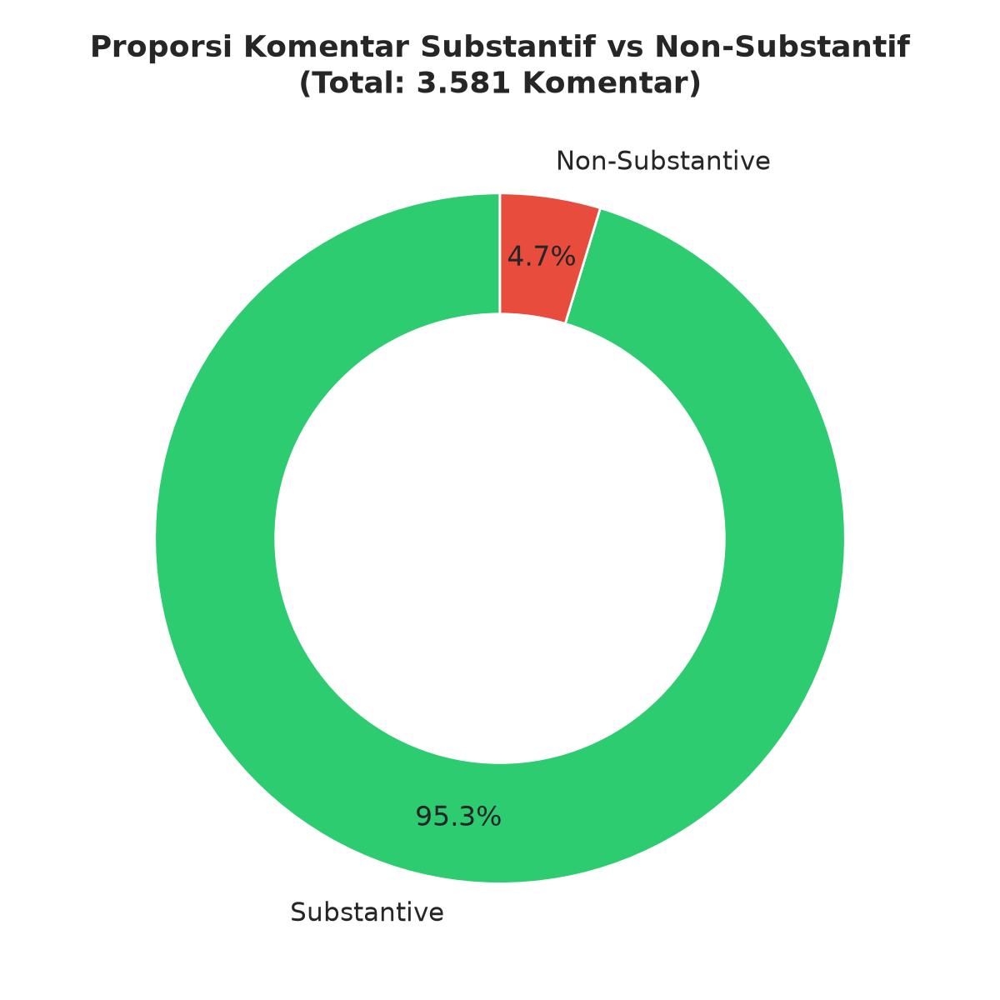
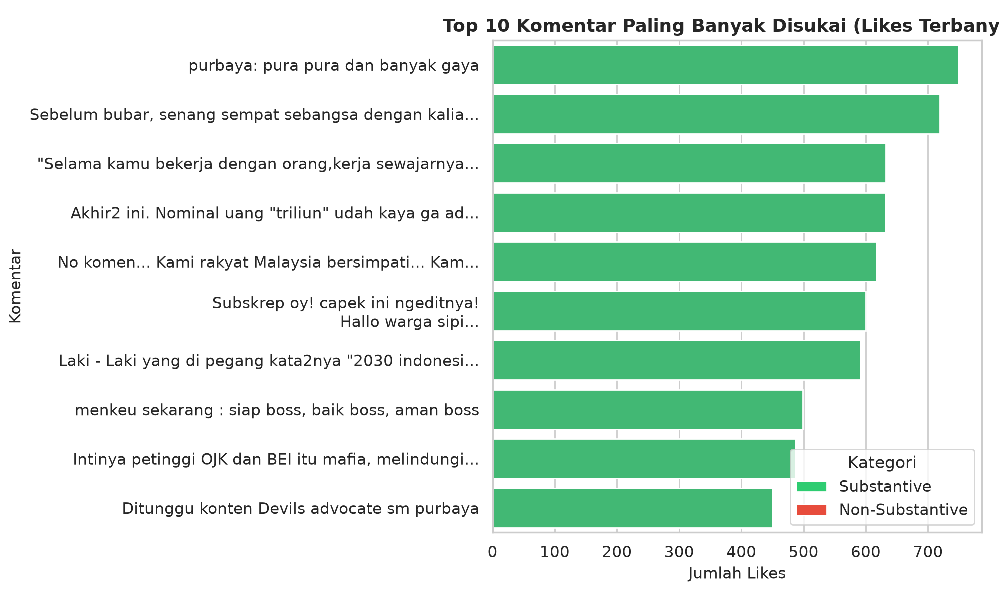
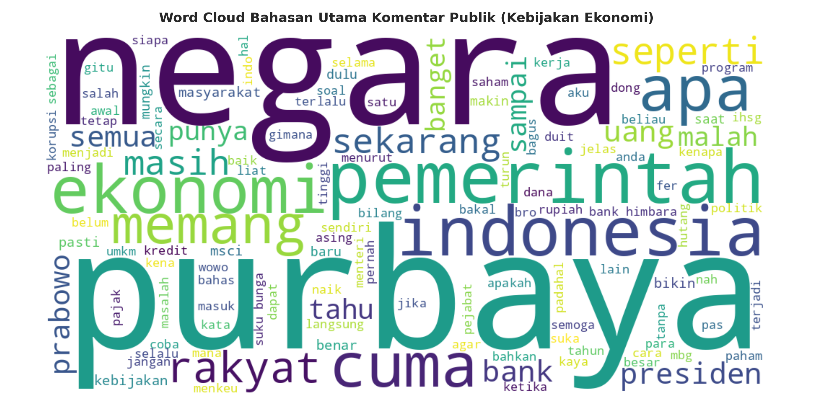

# 📊 Analisis Komparasi Opini Publik terhadap Kebijakan Ekonomi Nasional di YouTube
### Tugas Besar Mata Kuliah Analisis Media Sosial (AMS)

[](https://www.python.org/downloads/)
[](notebooks/analisis_opini_publik_ekonomi_youtube.ipynb)
[](data/)
[](https://colab.research.google.com/github/favjiw/ams-youtube-economic-sentiment/blob/main/notebooks/analisis_opini_publik_ekonomi_youtube.ipynb)

Repository ini berisi proyek analisis media sosial berbasis penambangan teks (*text mining*) dan *web scraping* pada kolom komentar YouTube. Proyek ini menganalisis **3.634 komentar mentah (3.581 komentar bersih)** dari 4 video analitis seputar kebijakan ekonomi Indonesia di kanal **@FerryIrwandi**.

---

## 📌 Latar Belakang & Pertanyaan Analisis

Tugas ini dirancang untuk menjawab pertanyaan inti analisis media sosial:
1. **Scraping Data YouTube Skala Menengah:** Mengumpulkan data komentar multi-video terkini tanpa batasan kuota API konvensional.
2. **Analisis "Berapa Banyak yang Suka":** Menganalisis metrik *engagement*, distribusi *like count*, serta pola komentar paling viral/didukung audiens.
3. **Analisis "Apa Bahasannya":** Mengekstraksi topik semantik, kata kunci dominan, *n-grams*, dan visualisasi *Word Cloud* pada masing-masing topik kebijakan.
4. **Klasifikasi Substantif vs Non-Substantif:** Menyaring *noise* media sosial seperti spam promo judi online/pinjol, penanda waktu (*timestamp*), *mention reply*, emotikon murni, dan basa-basi (*phatic*).
5. **Sampling Dataset di Colab:** Menyediakan representasi cuplikan dataset dalam bentuk tabel Markdown.

---

## 🗂️ Struktur Direktori

```
ams-youtube-economic-sentiment/
├── README.md                                             # Dokumentasi lengkap proyek
├── requirements.txt                                      # Dependensi Python
├── notebooks/
│   └── analisis_opini_publik_ekonomi_youtube.ipynb       # Notebook utama (siap Colab / VSCode)
├── data/
│   ├── raw_youtube_comments.csv                          # Data mentah hasil scraping (3.634 baris)
│   └── cleaned_youtube_comments.csv                      # Data bersih berlabel sentimen & kategori (3.581 baris)
├── scripts/
│   ├── crawl_comments.py                                 # Script crawling multi-video YouTube
│   ├── process_and_analyze.py                            # Pipeline pembersihan teks & grafik
│   └── build_notebook.py                                 # Builder notebook otomatis
└── reports/
    ├── laporan_analisis_ams.md                           # Dokumen laporan resmi tugas AMS
    └── figures/                                          # Grafik & visualisasi hasil analisis
        ├── 01_substantive_distribution.png
        ├── 02_video_substantive_comparison.png
        ├── 03_sentiment_by_video.png
        ├── 04_top_liked_comments.png
        ├── 05_wordcloud_ekonomi.png
        └── 06_hourly_distribution.png
```

---

## 🎥 Video yang Dianalisis (*Multi-Video Dataset*)

| No | Video ID | Judul Video | Kategori Topik | Jumlah Komentar |
|:---:|:---:|:---|:---|:---:|
| 1 | `5jQBJTGW1xg` | Hal-Hal yang Harus Dipertahankan dan Ditingkatkan dalam Kebijakan Purbaya | Kebijakan Fiskal Purbaya | 634 |
| 2 | `knbWmkzxClA` | Menyoal Kebijakan Menkeu Purbaya Memindahkan 400 Triliun Dana SAL ke Himbara | Kebijakan Dana SAL 400T | 1.000 |
| 3 | `hsZzNqL2yVA` | Memahami Masalah MSCI dan Dampaknya ke Ekonomi Indonesia | Pasar Modal & Indeks MSCI | 1.000 |
| 4 | `8I9exkh2MXI` | Memahami Konsep Trilemma Moneter dan Macro Financial Doom Loop di Perekonomian Indonesia | Kebijakan Moneter & Doom Loop | 1.000 |

---

## 📑 Cuplikan Sampling Dataset (Markdown Table)

| Comment ID | Topik Video | Author | Cuplikan Komentar Asli | Likes | Kategori | Sentimen |
|:---|:---|:---|:---|:---:|:---:|:---:|
| `C00001` | Kebijakan Purbaya | `@ferryirwandi` | "Hallo warga sipil sekalian selamat menyaksikan dan selamat menonton" | 241 | `substantive` | Positif |
| `C00002` | Kebijakan Purbaya | `@fajrinanggoro6766` | "Selama kamu bekerja dengan orang, kerja sewajarnya saja by Purbaya..." | 632 | `substantive` | Positif |
| `C00005` | Kebijakan Purbaya | `@ikhsan7539` | "next undang pak purbaya di devils advokat pakk" | 6 | `substantive` | Netral |
| `C00010` | Kebijakan Purbaya | `@kukuhgalangr` | "ngaco ini menkeu yg baru, belum apa2 udh blunder diwawancara bloomberg..." | 0 | `substantive` | Negatif |
| `C00012` | Kebijakan Purbaya | `@user-zn8...` | "❤‍🔥❤‍🔥❤‍🔥" | 2 | `emoji_or_symbol_only` | Netral |
| `C00045` | Dana SAL 400T | `@investor_pemula` | "Uang 400T ditaruh di himbara itu bahaya kalau kredit macet membengkak..." | 749 | `substantive` | Negatif |
| `C00120` | Dana SAL 400T | `@promo_berkah` | "SIAP 46 BERKAH 99 KUNJUNGI LINK..." | 0 | `suspected_promo` | Netral |
| `C00640` | Pasar Modal MSCI | `@trader_saham` | "MSCI rebalancing bikin asing capital outflow, IHSG nyungsep parah..." | 617 | `substantive` | Negatif |
| `C00750` | Pasar Modal MSCI | `@edukasi_finansial` | "Penjelasannya sangat bagus dan masuk akal, tercerahkan sekali bang!" | 185 | `substantive` | Positif |
| `C01100` | Trilema Moneter | `@mahasiswa_fe` | "04:15 - trilema moneter pas banget jelasin kondisi BI saat ini" | 12 | `timestamp` | Netral |

---

## 📈 Ringkasan Temuan Analisis

### 1. Kualitas Diskusi (Substantif vs Non-Substantif)
* **Tingkat Substantif: 95,3% (3.413 komentar)**.
* **Non-Substantif: 4,7% (168 komentar)** yang mencakup 25 promo spam (judi online/skincare), 38 emoji murni, 34 basa-basi (*phatic*), dan 24 timestamp.
* Menunjukkan tingginya kualitas diskusi pada kanal edukasi publik di YouTube.



### 2. Berapa Banyak yang Suka (*Engagement Analysis*)
* Akumulasi interaksi menyentuh **22.641 total likes**.
* Video mengenai **Pasar Modal & Indeks MSCI** mengumpulkan likes terbanyak (**9.666 likes**, rerata **9,67 likes/komentar**).
* Komentar dengan like tunggal tertinggi (**749 likes**) berasal dari video Dana SAL Rp400T yang mengkritisi risiko kredit macet perbankan.



### 3. Apa Bahasannya (*Word Cloud & Semantic Topics*)
* **Fiskal & Purbaya:** `purbaya`, `menteri keuangan`, `pajak`, `kerja`, `reformasi`.
* **Perbankan & Likuiditas:** `bank`, `himbara`, `kredit`, `bunga`, `dana`, `sal`.
* **Pasar Modal:** `msci`, `saham`, `ihsg`, `outflow`, `investor`.
* **Moneter:** `trilema`, `inflasi`, `rupiah`, `dolar`, `bi`.



---

## 🚀 Cara Menjalankan Proyek

### 1. Melalui Google Colab (Paling Mudah)
Klik tombol badge [Open In Colab](https://colab.research.google.com/github/favjiw/ams-youtube-economic-sentiment/blob/main/notebooks/analisis_opini_publik_ekonomi_youtube.ipynb) di atas. Notebook secara otomatis akan mengunduh dataset dari repository ini jika tidak tersedia secara lokal.

### 2. Melalui Local Environment
```bash
# 1. Clone repository
git clone https://github.com/favjiw/ams-youtube-economic-sentiment.git
cd ams-youtube-economic-sentiment

# 2. Install dependencies
pip install -r requirements.txt

# 3. Jalankan pipeline analisis
python scripts/process_and_analyze.py

# 4. Buka Jupyter Notebook
jupyter notebook notebooks/analisis_opini_publik_ekonomi_youtube.ipynb
```

---

## 👤 Identitas & Lisensi
* **Author:** Muhammad Favian Jiwani ([@favjiw](https://github.com/favjiw))
* **Mata Kuliah:** Analisis Media Sosial (AMS)
* **Lisensi:** MIT License
